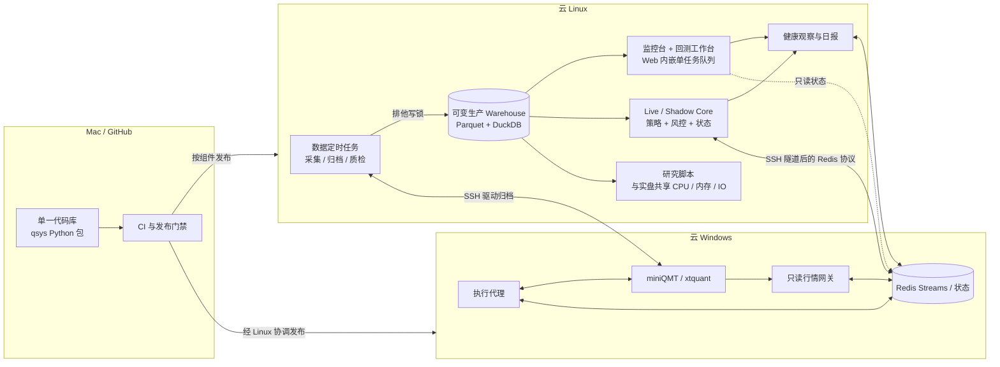
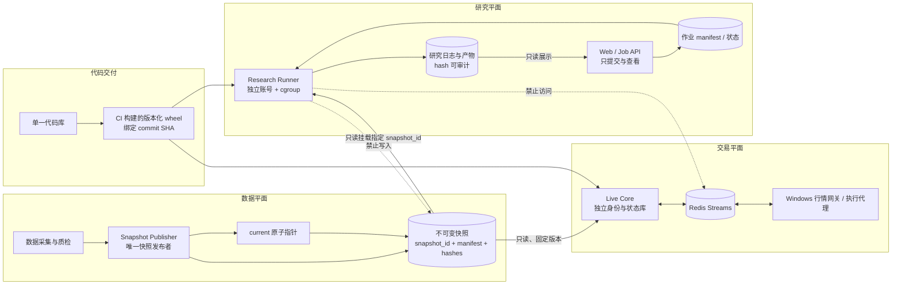

# qsys：个人量化交易系统

qsys 是一套面向 A 股的自建量化交易系统，覆盖数据采集与治理、策略研究、事件驱动回测、
模拟/影子运行、实盘交易、监控告警和跨 Linux/Windows 发布。项目的目标不是堆叠策略，
而是让同一套策略与交易语义能够被验证、复现、审计，并在真实资金链路中失败关闭。

> 系统包含真实交易能力。示例配置永久禁用下单；任何生产发布、账户操作或安全配置变更，
> 都必须遵循生产门禁和回滚流程。

## 项目背景

项目最初用于替代“聚宽策略运行时 → Redis → Windows → miniQMT”的前半段平台能力。
现阶段数据、策略、回测、运行时与运维控制面已经自建；Windows 侧继续保留轻量的 QMT
行情与执行适配层。

主要解决以下问题：

- 数据、撮合和费用模型可解释，不依赖黑盒平台。
- 历史研究与实盘使用同一套策略、约束和订单语义。
- 日线、分钟线、竞价 Tick、停复牌、涨跌停价与基本面数据可追溯、可质检。
- Linux 决策与 Windows 执行解耦，跨节点故障能够熔断、恢复和对账。
- 每次代码发布、数据发布、研究运行和交易事件均留下可审计证据。

## 主要功能

| 领域 | 当前能力 |
|---|---|
| 数据 | Tushare 日线与参考数据、QMT 分钟线/竞价 Tick、Parquet 分区、DuckDB/Polars 查询、数据目录与质量规则 |
| 策略 | 显式上下文、参数校验、结构化首板策略、统一交易约束与调度 |
| 回测 | 事件驱动撮合、费用/滑点、公司行为、绩效指标、运行产物与对照报告 |
| 交易 | 模拟盘、影子盘、实盘核心、Redis Streams 协议、QMT 执行代理、行情网关 |
| 风控 | 账户保护、仓位与流动性限制、心跳门禁、kill switch、超时熔断、日终对账 |
| 研究 | 首板、竞价、门禁归因、AI 涨停概率榜单及固定样本外验证 |
| 运维 | FastAPI 监控台、运行记录、健康时刻轴、告警、日报、备份与故障演练 |
| 发布 | 基于 commit SHA 的测试/生产门禁、组件影响分析、Linux/Windows 原子发布与回滚证据 |

## 架构结论

当前系统适合继续采用 **模块化单体 + 少量强隔离服务**，而不是把每个 Python 目录都拆成
微服务。独立服务的判断标准应是：是否需要独立的故障域、权限、资源上限、生命周期或发布
节奏。仅仅“代码可以复用”不构成拆服务理由。

这种形态兼顾了两点：

- 业务语义集中在一个版本化 `qsys` 包中，避免回测、研究和实盘各自实现一套规则。
- 运行时按风险边界独立：数据写入、交易决策、券商执行、Web、研究任务互不取得不必要权限。

### 当前生产拓扑

下图描述仓库和部署文档中已经存在的运行形态，而不是目标设计。



当前已经清晰的边界：

- Windows 行情网关只依赖 `xtdata`，没有账户和下单接口。
- Windows 执行代理负责订单翻译、回报和本地安全闸，不包含策略逻辑。
- Linux live core 是交易决策与风控主体；券商不可用或心跳异常时失败关闭。
- 数据任务用统一写锁串行发布，Web、策略和研究通过数据访问层读取。
- 部署契约将改动映射到 Linux Web、常驻服务、数据任务、systemd、Windows agent 和
  Windows gateway 等组件，支持按影响范围发布。

当前仍需改进的边界：

- 生产 Warehouse 是持续变化的目录，研究运行没有绑定不可变的数据版本。
- Web 进程内部启动回测队列与子进程，Web 故障域和重型计算故障域尚未分离。
- 研究脚本以普通进程运行，与实盘共享宿主机 CPU、内存和 IO，缺少硬资源上限。
- 研究运行缺少统一的代码 SHA、数据快照、参数、日志、产物 hash 与失败原因契约。
- “只读生产数据”目前主要依赖进程约定和 systemd 路径权限，尚未形成独立研究身份的
  完整负向权限证明。

## Issue #285 目标架构

[#285](https://github.com/wanlinruo/quant-trade/issues/285) 不需要全面微服务化。它要新增的
核心边界只有两个：**不可变快照发布边界**和**隔离研究执行边界**。



### 服务边界与所有权

| 运行单元 | 独占职责 | 可读 | 可写 | 独立部署/资源 |
|---|---|---|---|---|
| Snapshot Publisher | 校验并原子发布不可变数据快照 | 采集暂存区 | 新快照与 `current` 指针 | 独立定时任务；唯一快照发布权限 |
| Live Core | 策略决策、组合状态与交易风控 | 固定快照、Redis 行情/回报 | 自有状态库、订单 Stream | 独立用户与 systemd unit；最高运行优先级 |
| Market Gateway | 从 QMT 读取行情并响应报价请求 | QMT 行情 | Redis 行情与心跳 | Windows 独立应用/任务；无下单权限 |
| Execution Agent | 委托执行、回报、账户快照与本地熔断 | 订单 Stream、QMT 账户 | QMT 委托、回报 Stream、自有 ledger | Windows 独立应用/任务；无策略逻辑 |
| Web / Job API | 监控、查询、创建/取消研究作业 | 状态库、产物、快照元数据 | 作业控制库 | 独立 Web 服务；不执行重计算 |
| Research Runner | 按 manifest 执行一次研究作业 | 指定 wheel、指定快照 | 专属作业目录 | `qsys-research` 用户；Memory/CPU/IO/并发/超时硬限制 |
| Health Observer | 跨服务只读探测与告警 | 心跳、状态和运行记录 | 自有健康时刻轴 | 独立常驻服务；故障不影响交易主链 |

关键规则：

1. **复用代码，不共享进程。** 所有运行单元安装同一 commit 构建的 `qsys` wheel；交易规则、
   费用、数据访问和策略接口继续复用，Web 与研究执行器不再同进程运行。
2. **数据通过版本传递。** 作业接收 `snapshot_id`，而不是模糊的 `warehouse/current` 路径；
   manifest 至少包含完整日期、schema 版本、分区清单和内容 hash。
3. **每个写入只有一个所有者。** 快照、交易状态、执行 ledger、研究产物和作业控制库分别
   由对应服务写入，其他服务只读。
4. **跨故障域用稳定契约。** 跨节点继续使用版本化 Redis 消息；跨进程数据使用 snapshot
   manifest 和 job manifest；进程内模块继续使用 Python 类型，不为拆分而引入网络调用。
5. **发布独立但版本可追溯。** 服务可以按部署组件独立升级和回滚，每次运行仍记录完整
   commit SHA、wheel hash、配置公开指纹和 snapshot ID。
6. **研究权限默认拒绝。** Runner 不持有券商账号、Redis 订单 Stream 凭据、生产状态库写权
   或 Warehouse 写权；资源超限只能终止自己的作业。

### #285 建议实施顺序

1. 定义并测试 snapshot manifest、不可变目录布局与原子发布/回滚协议。
2. 将现有 Web `BacktestQueue` 的执行职责迁到独立 Runner；Web 仅保留作业控制与查看。
3. 建立 `qsys-research` 身份、只读快照挂载及订单/生产状态/仓库写入的负向测试。
4. 为 Runner 增加 systemd/cgroup 的内存、CPU、IO、超时与并发限制。
5. 补齐 job manifest、状态机、取消、失败恢复、日志和产物 hash。
6. 在测试环境完成压力演练，再于维护窗口接入生产；达到资源阈值后再评估独立研究节点。

快照协议见 [`docs/reference/warehouse-snapshots.md`](docs/reference/warehouse-snapshots.md)，
Web/Runner 作业边界见 [`docs/reference/research-runner.md`](docs/reference/research-runner.md)。

## 代码结构

```text
src/qsys/
├── core/       与市场和数据源无关的类型、时钟、事件、组合与约束
├── data/       数据访问、存储、目录、采集流水线与质量规则
├── markets/    A 股市场规则
├── strategy/   策略接口、参数、调度和结构化策略实现
├── backtest/   事件驱动回测、撮合、费用、滑点、指标和产物
├── paper/      模拟交易运行时与报价客户端
├── live/       实盘/影子运行时、消息、风控、状态与 Redis 传输
├── agent/      Windows QMT 执行代理
├── research/   研究数据集、模型与归因逻辑
├── web/        FastAPI 监控台和工作台
└── ops/        健康、告警、运行记录、日报和部署辅助

scripts/        各运行单元入口、数据作业、研究与运维命令
strategies/     可加载的策略入口
deploy/         机器可读部署契约、systemd unit 与跨节点发布控制器
docs/           设计、数据口径、研究证据、部署和运行手册
tests/          单元、集成、契约与回归测试
```

依赖方向原则：`core` 不依赖具体数据源或券商；策略通过显式上下文访问数据、组合和订单；
Windows agent 不依赖策略；Web 只编排和展示，不承载交易业务规则。

## 数据与状态

- 生产数据仓库位于数据盘，主要使用 Parquet 分区；DuckDB/Polars 用于查询和计算。
- 实时请求、命令、回报、状态与心跳通过 Redis Streams/keys 传递。
- live/shadow、执行代理、Web 工作台和健康观察各自使用独立 SQLite 状态库。
- 数据写任务通过全局 warehouse 写锁串行；#285 完成后，消费者将读取显式不可变快照。
- 实时交易事实不能被研究结果覆盖；研究产物进入独立目录并标注代码、数据和参数版本。

## 环境与发布

| 环境 | 用途 | 约束 |
|---|---|---|
| Mac | 开发、本地测试和小规模研究 | 不承担 24×7 生产职责 |
| Test Linux | `test` 分支自动部署后的集成验证 | 禁止下单；与生产 Redis、状态和路径隔离 |
| Production Linux | 数据任务、Web、策略核心、研究与运维 | 生产发布必须从 `main` 手工触发并通过健康门禁 |
| Production Windows | miniQMT、行情网关、执行代理与 watchdog | 无策略逻辑；应用独立原子发布和回滚 |

`deploy/deployment.toml` 是服务影响范围和部署边界的机器可读事实来源。CI 对完整 SHA 执行
策略检查、secret 扫描、全量测试和构建；测试部署成功后，生产发布仍需显式人工门禁。

## 本地开发

要求 Python 3.11+ 和 [uv](https://docs.astral.sh/uv/)。

```bash
uv sync --locked
uv run pytest
uv build
```

运行命令默认不得视为生产授权。需要接入真实数据或节点时，使用本地私有配置，并先阅读相应
部署手册；不要把 token、账号、密码、私钥或完整生产配置写入仓库和日志。

## 文档入口

- [系统原始设计](docs/superpowers/specs/2026-09-06-personal-quant-system-design.md)
- [部署契约](docs/reference/deployment-contract.md)
- [服务管理与每日质检](docs/reference/service-management.md)
- [策略数据依赖](docs/reference/strategy-data-dependencies.md)
- [实盘运行手册](docs/deploy/live-trading.md)
- [Linux 节点手册](docs/deploy/linux-core.md)
- [Windows 节点手册](docs/deploy/windows-node.md)
- [生产发布清单](docs/deploy/production-release-checklist.md)
- [文档索引](docs/reference/README.md)

项目实时状态、验收证据和后续工作以 GitHub Issues、Actions、部署记录及节点健康检查为准；
历史设计文档用于解释决策，不应覆盖当前机器可读契约和现场事实。
