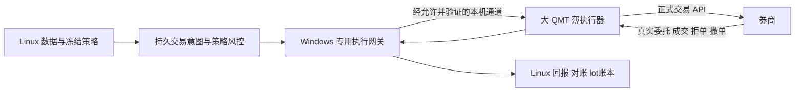

# 外部决策与大 QMT 薄执行器：可行性分析报告

日期：2026-11-05。承接 [#599](https://github.com/wanlinruo/quant-trade/issues/599)，关联 #533 / #137。
依据：11-04至11-05当前客户端的无交易现场诊断、仓库执行链路审查、迅投与Microsoft正式文档。
这是可行性结论及工程建议；不是账户许可证明、生产发布记录或实盘启用指令。

**11-05 11:00进展增补（#601）：** 默认关闭的异步状态/持久账本/Core预留接线已实现，
Windows私有NTFS根及实际异步工厂已实测；固定合成ping端口现已接通QMT编辑器两段会话。
ACK后恢复旧意图时仍在有效期内，原attempt/nonce/ACK保持、旧意图零重发，新会话对照ping成功。
全量4580项通过、7项条件跳过。该端口不把意图JSON/市场/账户字段发送给QMT，
因此不证明真实信号或交易链路已通。正式模式、生产身份、完整客户端重启和原生交易回报仍待验，
实盘建议保持不变。详见[应用接线](qmt-async-dispatch.md)及
[独立复核摘要](qmt-async-qmt-probe-20261105.json)。

## 1. 结论与建议

**建议有条件采用“Linux外部决策 → Windows专用执行网关 → 大QMT薄执行器”作为下一阶段主线。**

核心依据已经超过“理论上可能”：当前江海QMT 2.1.33.0的编辑器模拟环境，实际完成了
外部消息双向收发、正式调度API消费、错误消息拒绝，以及Windows持久账本与接收器的恢复接线。
因此，没有必要继续把“全策略、全部历史输入与业务状态必须搬进QMT”作为唯一恢复路线。

但当前证据**不足以恢复实盘**。尚未证明当前券商账户允许该接入方式、策略交易实际运行模式
具有同样能力，也未完成真实委托受理/成交/撤单回报、生产身份认证及完整客户端重启恢复验收。
本次没有调用账户、下单或撤单，没有绑定账户、清KILL、启动Live/Shadow或接入真实意图流。

建议暂缓扩大完整原生策略移植，先解决正式运行模式/券商接入许可及异步回报契约。
若这两项不能满足，不能依靠已成功的编辑器IPC强行上线。

## 2. 已验证到哪一层

| 层级 | 现场结果 | 仍不能推出的结论 |
| --- | --- | --- |
| 外部Windows进程通信 | 命名管道5帧、单向5181字节，双向SHA一致、对端PID互证 | 不能代表QMT内部可收消息 |
| QMT模块能力 | 实际Python3.12.10；json/socket/ctypes/mmap可导入，WinDLL属性存在；win32pipe/win32file未安装 | 导入不代表网络、文件或DLL调用获准；本轮没有调用它们 |
| QMT内单次IPC | 标准mmap命名共享内存，QMT读248字节、回216字节；双端编号与独立重建响应SHA一致 | 单次成功不证明正式模式或长期稳定 |
| 正式调度API消费 | 编辑器中schedule_run实际8次回调处理8条；3条不同有效消息被接受，其余按规则处理 | 使用正式API不等于已在实盘模型模式验收 |
| 消息守卫 | 重复原请求回原响应；错签、乱序、过期、同ID改内容拒绝；独立校验8组HMAC/SHA | 密钥为公开fixture，不是生产身份认证；内存缓存不跨重启 |
| Windows持久恢复接线 | 实际SQLite3.49.1；发布后退出、ACK后退出、接收器结束后无回报均保留unknown；第一阶段有效期内重领被拒 | 不是柜台交易的端到端exactly-once，也不是掉电验收 |
| 旧原型新接收会话 | 原账本保持、旧消息未再发布，仅处理新D；新缓存只含1条 | 原型当轮旧消息已过期，不能单独证明有效期内防重 |
| 实际应用新接收会话（11:00增补） | ACK后、到期前重投旧意图零发布；新会话仅处理独立对照ping，原尝试/ACK保持 | 只覆盖该故障组合；不是客户端重启或真实信号/委托受理验收 |
| 真实受理与回报 | 未执行 | 不能宣称可以实际下单、已恢复账户或已通过实盘验收 |

本地65项专项通过；已有单次诊断代码有一条datetime.utcnow弃用提示，不影响上述测试结论。
密钥扫描和diff检查通过。尚未完成本轮GitHub CI、测试部署或生产发布。

主要证据：

- [单次能力与IPC机器摘要](qmt-external-signal-probe-20261104.json)。
- [8条消息组合诊断](qmt-external-queue-probe-20261104.json)。
- [Windows恢复接线机器摘要](qmt-external-recovery-probe-20261105.json)。
- [发送恢复契约与完整过程](qmt-external-dispatch-recovery.md)。

## 3. “Python限制”和“Windows内核”应如何理解

本次可确认的事实是：当前编辑器允许使用标准库mmap创建/打开指定命名共享内存，完成固定
合成消息交换。没有修改客户端、补装被拒模块、替换hook、注入进程、调用ctypes.WinDLL，
也没有利用日志输出承载交易信号。

这支持“Python层的某些限制，并不自动意味着所有进程通信都不可能”。但“Windows内核锁不住”
不是准确的通用结论。Windows仍可用AppContainer、访问令牌、对象DACL与会话隔离限制访问。
11-04对旧PID4968只查了两个token属性，不能代表当前PID5480及全部策略进程；本次成功也
不代表其他接口或正式运行模式必然可用。[Microsoft AppContainer说明](https://learn.microsoft.com/en-us/windows/win32/secauthz/appcontainer-isolation)。

券商当前公告明确限制内置Python文件读写和外部网络。我们取得的是诊断能力证据，没有取得
该公告下外部交易信号接入的账户许可。因此，“技术通道能收消息”和“该账户允许用它下单”必须分开。

## 4. 推荐架构与职责



| 位置 | 保留/承担的职责 |
| --- | --- |
| Linux | Tushare等既有真值源、数据质量、指标/选股、冻结参数、调度、策略lot/FIFO、资金仓位风控、意图与回报真值 |
| Windows网关 | 专用最小配置、认证与会话、持久发送尝试、单实例/租约、输入与账户绑定核验、IPC、真实回报规范化及重连对账 |
| QMT薄端 | 有界回调、白名单指令、最后一跳时效/身份/风险门禁、正式下单撤单API与原生回报；尽量不承载策略和历史业务账本 |

行情数据Gateway继续只承担原数据职责，不把现有只读入口扩大为交易权限入口。
网关不能提供任意Python函数RPC、任意脚本执行或任意文件读写。

### 4.1 新路线带来的实际收益

- 保留既有策略与数据治理，避免为恢复执行重复移植全套历史股票池、股本PIT、复权锚点和指标。
- 原业务账本可继续位于外部稳定存储，降低对QMT内部持久化能力的依赖。
- 将当前不稳定的执行接入与策略计算分开验证，减少换源和移植同时改变策略结果的风险。
- 北交所行情继续参与全A情绪，交易边界继续禁止北交所新开仓；不因账户无权限裁剪行情分母。

这些收益不豁免数据质量或阈值冻结。必需输入按实际消费者、版本和时效验收；不能为上线改市场
事实、放宽质检、以当前持仓反推策略lot，或把未消费历史警告机械等同当前策略必需输入失败。

## 5. 必须改造的执行契约

### 5.1 passorder没有同步券商单号

迅投文档说明passorder不返回值；用户ID可通过备注字段关联委托/成交，策略名区分受本地客户端
作用域限制。备注关联的完整性、长度、唯一性、跨日与重启可见性仍须当前版本实测，不能假定
用户ID等于柜台幂等键。[正式交易函数说明](https://dict.thinktrader.net/innerApi/trading_function.html)。

目前的[BrokerAdapter](../../src/qsys/agent/adapter.py)要求place_order同步返回真实券商单号。
[ExecutionAgent](../../src/qsys/agent/execution_agent.py)会先find_order，这是有价值的预查；但查询
未找到不能证明柜台从未受理。旧[IdempotencyGuard](../../src/qsys/live/idempotency.py)在handler
成功返回后才记结果，不能直接覆盖新的“已调用但单号尚未出现”窗口。

**建议增加独立异步发送端口，保留旧适配器兼容路径；不把None、临时编号或通信ACK伪装成券商单号。**

### 5.2 发送unknown与券商订单状态分开

当前[OrderStatusEvent](../../src/qsys/live/messages.py)要求broker_order_id，适合已有真实单号的
订单状态。还没有真实单号的发送unknown不能靠空字符串补齐该字段。
建议另设意图发送状态事件，携带client_order_id、attempt_id、会话、发送阶段与原因，未知单号保留null。
现有OrderCommand的session_id/strategy_id允许空串兼容，桥接新单入口应要求显式身份绑定，
不能借旧默认值放行；兼容旧记录的读取能力不等于允许旧会话产生新单。

```text
prepared → dispatching → transport_received → 真实 broker_accepted → 部分成交/终态
                 └────────结果不足或断线────────→ unknown → 查询对账
```

prepared只在时间和所有门禁满足后原子领取；dispatching必须先持久化，再发生外部效果。
unknown不自动改回prepared；ACK仅表示传输事实。真正的接受、成交、拒单、撤单来自券商事实。
本地SQLite与券商不能共享原子事务，不能承诺只靠缓存实现端到端exactly-once。
保守unknown可能冻结实际尚未发出的意图，这是避免重复执行的可用性成本，需要明确对账入口，
不能以重发来解除冻结。

[LiveBroker](../../src/qsys/live/live_broker.py)收到RejectEvent会释放pending。通信超时若被错误转成
拒单，会提前释放资金/数量预留，继而可能放大风险。因此unknown期间应保留pending和预留，
直到真实终态或明确对账裁决；不能拿超时推定拒单或成交。

### 5.3 回报路径是恢复交易的必要条件

需要同时验证真实推送和有范围/时间绑定的查询：委托、成交、拒单、撤单、资金、持仓及活动委托。
推送缺失时只读查询补事实，查询空值或旧快照不能视为无单。数量推进以真实逐笔成交为准，
避免状态回报与成交回报重复扣减；原业务lot与历史指纹保留。

迅投文档将相关主推限定于实际交易运行并要求账号订阅；编辑器探针不能替代它。
[正式主推函数说明](https://dict.thinktrader.net/innerApi/callback_function.html)。
当前编辑器探针未见全局get_history_trade_detail_data，不能依据通用文档假定该版本历史查询已可用。

## 6. 生产化前尚未解决的重点

| 项目 | 当前缺口 | 通过条件 |
| --- | --- | --- |
| 账户与正式模式 | 只有无账户编辑器证据 | 确认券商允许接入方式；在允许环境验证实际策略模式的收发、调度和原生回报 |
| 身份与密钥 | 公开fixture key、同SID共享对象 | 明确威胁边界、私有密钥分发/轮换、可信启动与会话/实例身份；拒绝伪造、旧会话和失效租约 |
| 会话命名空间 | 本次双方均在session1、使用Local命名对象 | 实际网关与QMT会话绑定；验证RDP断开、会话切换和无人值守启动，不假定后台服务可直接访问 |
| 并发与长期运行 | 单生产者/单消费者单槽测试 | 完成同步/可见性、背压、撕裂写、序号回绕、重连与持续运行测试 |
| 持久恢复 | 现场验证部分退出窗口及ACK后未过期跨会话恢复 | 补其他故障组合、完整客户端重启、重复实例、存储故障与真实柜台对账；生产故障演练另按授权执行 |
| 最后一跳风控 | 诊断不含证券/订单 | 当前账户绑定、证券身份、数量价格、资金仓位、北交所禁开仓及未知身份拒绝均在实际执行边界验收 |
| 急停与失联 | 目前没有真实执行器 | 无新鲜有效租约时禁止开仓；急停优先，撤单未知不盲重试，失联不绕过本地门禁 |
| 发布 | #598已完成main/test人工对齐及新SHA CI；本轮候选仍未发布 | 正常CI/测试部署/自审/最小组件发布及三方记录核验；诊断成功不冒充生产激活 |

Windows的Local对象属于会话命名空间，session0服务与session1客户端并不天然共享该对象。
不能通过盲改Global前缀来跳过权限设计。[Microsoft会话命名空间说明](https://learn.microsoft.com/en-us/windows/win32/termserv/kernel-object-namespaces)。

本次要求前台是为了安全地安装和执行UI诊断，不表示已经运行的IPC必须依赖窗口前台。
同样，目前没有证据证明它能在无人值守启动、RDP断开或会话变化后持续恢复。
生产密钥也不能沿用公开测试key或写入Git/日志；同SID其他进程可访问对象这一风险尚未隔离。

原生回调须有界，不能在共用策略线程内阻塞监听或无界等待。1秒轮询、120秒TTL只是诊断配置，
不是交易时延或失联阈值。本机回调毫秒数没有覆盖Linux网络、排队、调度等待和柜台受理，
不能称为端到端下单时延；竞价实际时刻仍须交易日验收。快速下单参数对历史bar也可能产生
不同触发行为，不能照抄示例值上线。
[迅投线程注意事项](https://dict.thinktrader.net/innerApi/user_attention.html)。

## 7. 与现有Issue的关系

| Issue | 新路线下的处理建议 |
| --- | --- |
| #599 | 可行性报告里程碑完成；整体接入、许可与生产验收仍未完成，继续开放 |
| #533 / #137 | 恢复跟踪保留，按薄执行器重新排必要前置，不因诊断成功关闭 |
| #541 | 从“全部内置恢复”转为外部账本+真实柜台恢复/对账；本次只是诊断子集，不能关闭 |
| #542 / #538 | 完整原生输入/复权不再必然是薄执行器前置；实际Linux消费输入和当前执行事实仍必须过验收 |
| #537 | 不必把全策略调度搬进QMT；保留薄端回调、实例身份、时效与跨日去重验收 |
| #535 | 失联、撤单未知和故障熔断继续作为必要安全条件 |
| #588 / #589 | 保留全A行情范围与北交所禁开仓；实际消费者和生产执行边界的接线仍需验收 |
| #600 | 新诊断目录已私有化；旧审计目录继承Users读取的问题仍待精确处置，不关闭 |
| #598 | 11-05已完成：test以exact lease对齐b82bd88并取得新SHA CI；提交关联API仍空，PR直接绑定与人工对账收据已保留 |

上述是按新路线提出的范围建议，未批量关闭Issue、放宽旧失败或更改生产账户与交易姿态。
旧miniQMT链路的历史实盘验收不等于新版已具备同样能力。

## 8. 建议推进顺序与停止条件

1. **先确认正式接入边界。** 核对当前江海版本/账户可用的正式运行模式、允许的外部指令通道、
   账号订阅、查询/主推字段及历史恢复范围。未确认就不做真实闭环。
2. **完成无交易工程化。** 将诊断端口做成默认关闭的异步适配器；引入独立发送状态事件、持久尝试、
   真实所有权与会话绑定，补未过期跨会话及撕裂写等测试，不使用真实意图Stream。
   11:00增补：隔离应用接线、私有NTFS根及ACK后未过期跨会话组合已验；其余生产身份、
   启动生命周期、其他故障组合和持续运行要求不因本轮通过而豁免。
3. **完成只读真实事实核验。** 在明确允许范围内证明当前资金/持仓/委托/成交字段、源时间、完整性及
   关联可用。不能靠编辑器里的函数存在或旧版本快照放行。
4. **最后才考虑真实闭环。** 在正常发布、必要生产门禁和具体真实交易授权齐备后，按既有小范围闭环
   规则验受理/成交/撤单与恢复。此前Live/Shadow及KILL保持现有姿态，不提前绑定账户或下单。

第1、2项可以并行准备；进入真实事实核验和真实闭环前，分别满足相应权限、事实与具体授权。

若正式策略模式禁用该通道、券商不允许当前账户使用、回报无法可靠关联，或unknown只能靠猜测消除，
应停止该通道的生产化，评估券商正式提供的其他入口，不通过修改客户端或绕过限制解决。

现阶段不提供实盘恢复日期：决定工期的关键是正式模式/账户权限和真实回报事实，而不是再多做几次
编辑器echo。报告可用于决定架构主线，不能用于宣布系统已可实盘。
